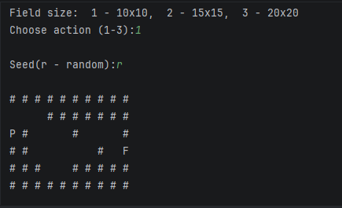

# 🚀 Labirint

Консольна гра-головоломка на C++ з **процедурною генерацією лабіринтів**: на кожен запуск — нове поле, яке гарантовано проходиться від старту до виходу.

**Стек:** C++17 · STL (`vector`, `fstream`) · Git/GitHub · g++ (MinGW) або Visual Studio 2022



---

## 🎯 Мета та опис проєкту

- **Яку задачу вирішує:** демонструє повний цикл навчального консольного застосунку на C++ — генерацію поля, керування гравцем, перевірку кожного ходу та збереження прогресу на диск.
- **Основне призначення:** гра «Лабіринт», де картка будується процедурно за **seed**-значенням → той самий сид дає ту саму карту (перевірюваність).
- **Гарантія проходимості:** вихід = кінець маршруту, який «вирізує» алгоритм генерації, тож шлях `S → F` існує завжди.

## ✨ Основний функціонал

- **Процедурна генерація:** поле заповнюється стінами, а «ходок» випадково вирізує неперервний маршрут за сидом
- **Відтворюваність:** `r` — випадковий сид (поточний час; у статистику пишеться конкретне число), числовий рядок — сид напряму, будь-який інший текст — сид із суми кодів символів
- **Захист вводу:** валідація кожного ходу (межі поля + перевірка стіни) та безпечне меню вибору розміру поля
- **Файлове сховище `<fstream>`:** лічильник перемог і повна історія сидів у `stats.txt` (текстовий формат)

## 🏗 Архітектура модулів

| Файл | Відповідальність |
|---|---|
| `Config.h` | спільні константи: розміри поля, символи, ім'я файлу статистики |
| `Labirint.h` / `Labirint.cpp` | клас `Labirint` (інкапсуляція: усі поля private) + реалізація генерації `generatePath()`, рух `movePlayer()`, малювання `draw()` + `main()` — точка входу та ігровий цикл |
| `ConfigManager.h` | файловий менеджер: `getGamesPlayed()` / `saveGameSession()` / `readSafeMenuChoice()` |

## 🎮 Керування

| Дія | Клавіша |
|---|---|
| Пошук сиду-заготовки | `r` + Enter (випадковий) або свій рядок-сид |
| Рух вгору / вниз | `w` / `s` |
| Рух вліво / вправо | `a` / `d` |
| Вибір розміру поля | `1` (10×10), `2` (15×15), `3` (20×20) |
| Сторонні клавіші | хід просто відхиляється — програма не падає |

## 🚀 Як запустити

```bash
git clone https://github.com/JustCrazySkill/labirint.git
cd labirint
g++ -std=c++17 Labirint.cpp -o Labirint.exe
./Labirint.exe
```

Або: відкрити `Labirint.exe` зі збірки Visual Studio 2022 (C++17).

## 📄 Приклад формату файлу даних (`stats.txt`)

```
2
Гра #1 | SEED: r (1769050400)
Гра #2 | SEED: abc
```

- перший рядок — лічильник завершених ігор;
- далі — історія: номер гри + сид. Якщо гра йшла за сидом `r`, у дужках фіксується число, яким заряджався генератор — **введи це число наступного разу як сид і отримаєш ту саму карту**.

## 👤 Автор

**Данило** · IT Step Academy · Група П53
GitHub: <https://github.com/JustCrazySkill/labirint>
